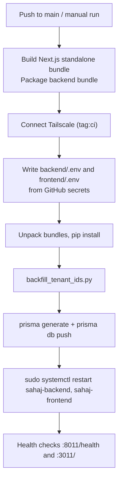

# Deployment Pipeline

SAHAJ has one GitHub Actions workflow, `.github/workflows/cd.yml`. There is no CI workflow and no automated test suite in the repository. Run the checks in CLAUDE.md section 5 locally before merging.

## Workflow

- **Triggers:** push to `main`, and `workflow_dispatch` (can be run on any branch from the Actions tab).
- **Concurrency:** group `production-deploy`, `cancel-in-progress: false`, so deploys never overlap.
- **Permissions:** `contents: read`. The SSH key is written per run and deleted at the end; host keys are checked strictly.
- **Database step:** `backfill_tenant_ids.py` fills any missing `tenant_id` from the row's user or student. It fails the deploy with a list of rows it cannot place. `prisma db push` runs without `--accept-data-loss`, so a schema change that would drop data fails the deploy instead of dropping it.
- **Restart:** the two systemd units are restarted through a sudoers rule that allows only those two commands. See [deployment-guide.md](deployment-guide.md).
- **Health checks:** the backend must answer 200 on `/health` within 2 minutes (it loads face models on boot). The frontend must answer on `/` (200 or the 307 to `/login`) within 30 seconds. On failure the last 40 `journalctl` lines of that unit are printed.

## Secrets

| Secret | Written to | Content |
| :--- | :--- | :--- |
| `PRODUCTION_BACKEND_ENV` | `backend/.env` (0600) | Database, JWT, Redis, S3, SMTP, `FRONTEND_URL` (CORS allow-list) |
| `PRODUCTION_FRONTEND_ENV` | `frontend/.env` (0600) | Next.js runtime variables and public endpoints |
| `SSH_PRIVATE_KEY`, `SSH_KNOWN_HOSTS` | runner `~/.ssh` | Deploy login to `jarvis` |
| `TS_OAUTH_CLIENT_ID`, `TS_OAUTH_SECRET` | Tailscale action | Reach the host over the tailnet |

Public hostnames are `sahaj.bytemap.in` (web) and `sahaj-backend.bytemap.in` (API).
