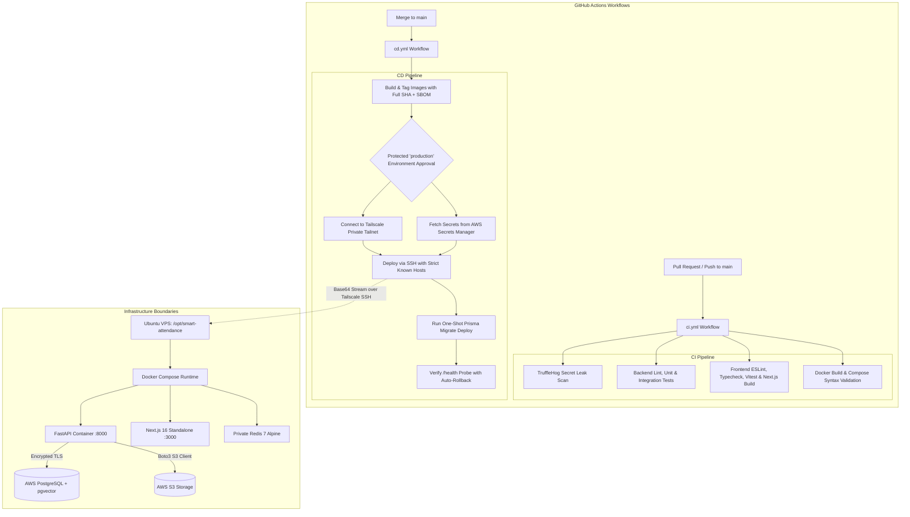

# Enterprise CI/CD Deployment Architecture

This document outlines the enterprise-grade Continuous Integration (CI) and Continuous Deployment (CD) setup for the **Smart Attendance System**, enforcing least-privilege access, immutable image artifacts, zero plaintext secret exposure, and automated health verification with rollback.

---

## 1. Pipeline Architecture



---

## 2. Workflows Overview

### A. CI Workflow (`.github/workflows/ci.yml`)
- **Triggers**: Pull requests targeting `main` and pushes to `main`.
- **Job Matrix**:
  1. `Security & Secret Leak Check`: Scans git history for exposed keys and tokens using TruffleHog.
  2. `Backend CI (Ruff, Pytest & Integration)`: Installs dependencies deterministically, runs static analysis, and executes all unit and integration tests.
  3. `Frontend CI (Lint, Typecheck, Test & Build)`: Runs ESLint, `tsc --noEmit`, Vitest tests, and validates that Next.js standalone production build completes without errors.
  4. `Validate Dockerfiles & Docker Compose`: Tests `docker compose config` syntax and validates multi-stage Docker builds.

### B. CD Workflow (`.github/workflows/cd.yml`)
- **Trigger**: Pushes to `main` (only builds and deploys trusted merged commits).
- **Security Controls**:
  1. **Job-Level Permissions**: `build-and-publish` only has `packages: write`; `deploy` has `id-token: write` (for AWS OIDC) and read-only repository permissions.
  2. **Pinned Action SHAs**: All actions are pinned to immutable 40-character commit hashes.
  3. **Immutable Image Tags**: Every build is tagged with the exact `${{ github.sha }}` and generates provenance and SBOM.
  4. **Strict SSH Host Key Verification**: Blind trust (`ssh-keyscan` on the fly) is prohibited. `SSH_KNOWN_HOSTS` must be provided.
  5. **Base64 Secrets Stream**: Injected directly into the target `.env` via a memory stream (`chmod 600`) without command-line parameter leakage or disk exposure on the runner.
  6. **Safe Migration Handling**: Prisma migrations are applied in a one-shot container before restarting application services (`prisma migrate deploy`).
  7. **Healthcheck & Rollback**: Probes `http://127.0.0.1:8000/health`. If the probe fails, automatically restores `.env.rollback` and rolls back containers.

---

## 3. GitHub Configuration & Prerequisites

### A. Create GitHub Environment (`production`)
1. Go to **Settings -> Environments -> New environment**.
2. Name: `production`.
3. Check **Required reviewers** and assign authorized team leads.
4. Deployment branches: select **Selected branches** -> `main`.

### B. Required GitHub Secrets & Variables

#### Repository Secrets (`Settings -> Secrets and variables -> Actions -> Secrets`)
| Secret Name | Description |
| :--- | :--- |
| `SSH_PRIVATE_KEY` | Private SSH key authorized on VPS (`~/.ssh/authorized_keys`). |
| `SSH_KNOWN_HOSTS` | Exact known_hosts line for your VPS (e.g. output of `ssh-keyscan -p 22 <vps-ip>`). |
| `TAILSCALE_AUTHKEY` | Tailscale auth key (or use `TS_OAUTH_CLIENT_ID` + `TS_OAUTH_SECRET`). |
| `AWS_ROLE_TO_ASSUME`| AWS IAM Role ARN for OIDC authentication. |
| `AWS_ACCESS_KEY_ID` | (Optional fallback if IAM Role OIDC is not used). |
| `AWS_SECRET_ACCESS_KEY` | (Optional fallback if IAM Role OIDC is not used). |

#### Repository Variables (`Settings -> Secrets and variables -> Actions -> Variables`)
| Variable Name | Default Value | Description |
| :--- | :--- | :--- |
| `VPS_HOST` | Required | Tailscale hostname or private Tailscale IP (e.g. `100.x.y.z`). |
| `VPS_USER` | `deployer` | Non-root Linux deployment user with Docker access. |
| `VPS_DEPLOY_PATH`| `/opt/smart-attendance` | Directory on VPS where Compose runs. |
| `SSH_PORT` | `22` | VPS SSH port. |
| `AWS_REGION` | `ap-south-1` | AWS region hosting Secrets Manager and RDS. |
| `AWS_SECRET_ID_DATABASE_URL` | `smart-attendance/production/database-url` | Secret ID for RDS PostgreSQL connection URL. |
| `AWS_SECRET_ID_JWT_SECRET` | `smart-attendance/production/jwt-secret` | Secret ID for production JWT signing secret. |
| `AWS_SECRET_ID_REDIS_PASSWORD`| `smart-attendance/production/redis-password` | Secret ID for internal Redis password. |
| `AWS_SECRET_ID_APP_ENV` | `smart-attendance/production/app-secrets` | Secret ID containing auxiliary production env keys. |
| `NEXT_PUBLIC_API_URL` | `/api/v1` | Public frontend API URL. |
| `NEXT_PUBLIC_WS_URL` | `/ws/connect` | Public WebSocket connection endpoint. |

---

## 4. VPS Initial Setup Instructions

Run these steps once on your Ubuntu VPS:

1. **Install Docker Engine & Compose Plugin:**
   ```bash
   sudo apt-get update && sudo apt-get install -y ca-certificates curl gnupg
   sudo install -m 0755 -d /etc/apt/keyrings
   curl -fsSL https://download.docker.com/linux/ubuntu/gpg | sudo gpg --dearmor -o /etc/apt/keyrings/docker.gpg
   sudo chmod a+r /etc/apt/keyrings/docker.gpg
   echo "deb [arch=$(dpkg --print-architecture) signed-by=/etc/apt/keyrings/docker.gpg] https://download.docker.com/linux/ubuntu $(. /etc/os-release && echo "$VERSION_CODENAME") stable" | sudo tee /etc/apt/sources.list.d/docker.list > /dev/null
   sudo apt-get update
   sudo apt-get install -y docker-ce docker-ce-cli containerd.io docker-buildx-plugin docker-compose-plugin
   ```

2. **Create Deployer User:**
   ```bash
   sudo useradd -m -s /bin/bash deployer
   sudo usermod -aG docker deployer
   sudo mkdir -p /opt/smart-attendance
   sudo chown -R deployer:deployer /opt/smart-attendance
   ```

3. **Install and Connect Tailscale:**
   ```bash
   curl -fsSL https://tailscale.com/install.sh | sh
   sudo tailscale up --ssh
   ```

4. **Verify Host Key:**
   On your local machine or trusted workstation, capture the known hosts entry for GitHub:
   ```bash
   ssh-keyscan -p 22 <vps-tailscale-ip>
   ```
   Add the exact output to GitHub Secret `SSH_KNOWN_HOSTS`.
