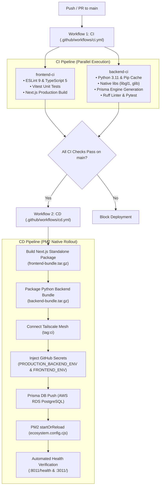

# CI/CD Pipeline Architecture

This document details the decoupled Continuous Integration (CI) and Continuous Deployment (CD) pipelines for the **Smart Attendance System**, establishing automated quality gates, secret management, and zero-docker native PM2 deployment.

---

## 1. High-Level Delivery Flow

---

## 2. Workflows Specification

### Workflow 1: Continuous Integration (`.github/workflows/ci.yml`)
- **Triggers**: `push: branches: [main]`, `pull_request: branches: [main]`, `workflow_dispatch`.
- **Concurrency**: `cancel-in-progress: true` (cancels superseded runs on subsequent pushes).
- **Parallel Jobs**:
  1. **`frontend-ci`**:
     - Environment: Node.js 22 LTS, npm caching.
     - Steps: `npm run lint` (ESLint), `npx tsc --noEmit` (TypeScript type check), `npm run test` (Vitest), `npm run build` (Next.js production validation).
  2. **`backend-ci`**:
     - Environment: Python 3.11, Ubuntu 24.04 runner.
     - System packages: `libgl1`, `libglib2.0-0` (required by OpenCV/DeepFace).
     - Steps: `pip install -r backend/requirements.txt`, `prisma generate`, `ruff check .`, `pytest tests/`.

---

### Workflow 2: Continuous Deployment (`.github/workflows/cd.yml`)
- **Triggers**: `workflow_run` (triggered only when `CI` finishes on `main`), `workflow_dispatch`.
- **Concurrency**: `group: production-deploy`, `cancel-in-progress: false` (prevents interleaved or corrupted deployments).
- **Security & Least Privilege**:
  - `contents: read`, `id-token: write`.
  - Ephemeral SSH keys generated per-run and purged upon completion.
  - Known hosts verification strictly enforced.
- **Packaging Pipeline**:
  - Next.js standalone build bundled with `public/` and `.next/static` into `frontend-bundle.tar.gz` (~30MB, transfers in <3s).
  - Python application source bundled into `backend-bundle.tar.gz`.

---

## 3. Secret Management & Injection

Environment files are never manually maintained on the host. They are centrally managed in GitHub Secrets and deployed with strict Linux file permissions:

| Secret Name | Deployment Target | Permissions | Description |
| :--- | :--- | :--- | :--- |
| `PRODUCTION_BACKEND_ENV` | `backend/.env` | `chmod 600` | Database credentials, JWT secrets, Redis URL, S3 credentials. |
| `PRODUCTION_FRONTEND_ENV` | `frontend/.env` | `chmod 600` | Next.js runtime environment and public endpoints. |
| `SSH_PRIVATE_KEY` | In-memory runner key | `chmod 600` | Tailscale deployer authentication key. |
| `SSH_KNOWN_HOSTS` | `~/.ssh/known_hosts` | `chmod 600` | Host key fingerprint for `jarvis`. |
| `TS_OAUTH_CLIENT_ID` | Tailscale Action | Ephemeral | Machine client ID for Tailscale ephemeral auth. |
| `TS_OAUTH_SECRET` | Tailscale Action | Ephemeral | Machine client secret for Tailscale ephemeral auth. |

---

## 4. Automated Health Verification

The CD pipeline runs automated HTTP health verification against both ports before marking deployment successful:
1. **Backend (`http://127.0.0.1:8011/health`)**:
   - Polled with `--retry 15 --retry-delay 3 --retry-connrefused` (up to 45s window to accommodate DeepFace/TensorFlow cold-start model weights loading).
   - Must return HTTP 200. Validates PostgreSQL connectivity, S3 storage, and AI engine status.
2. **Frontend (`http://127.0.0.1:3011/`)**:
   - Polled with `--retry 8 --retry-delay 2 --retry-connrefused`.
   - Must return HTTP 307 redirecting to `/login` or HTTP 200.
3. **Failure Diagnostics**:
   - If either gate fails, PM2 automatically streams the last 40 lines of error and standard logs to GitHub Actions and aborts with exit code 1.
