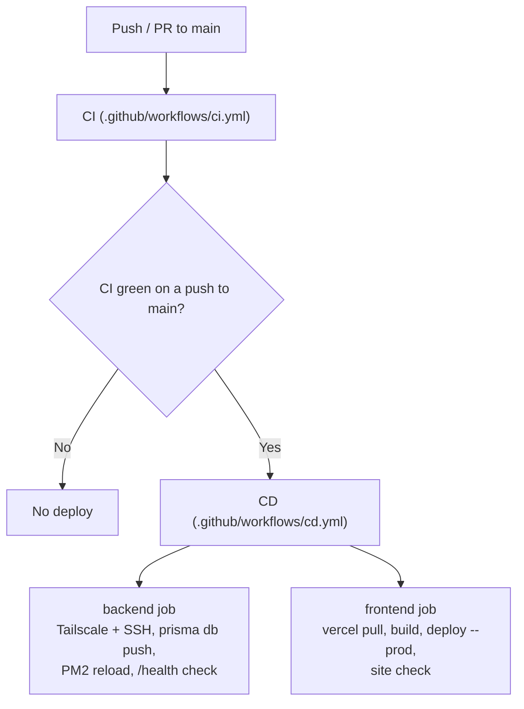

# CI/CD Pipeline

How code reaches production for **SAHAJ**. CI checks every change. CD runs only after CI is green on `main` and ships two things independently:

- the **API** to the server `jarvis`, with PM2
- the **web app** to Vercel

---

## 1. Delivery flow

---

## 2. Workflows

### CI (`ci.yml`)
- Triggers: push and pull request on `main`, and manual run. A newer run cancels an older one.
- Jobs run in parallel and `CI result` requires all of them: backend lint, backend unit tests, backend integration tests (PostgreSQL with pgvector, and Redis), web lint, types, tests and build, and mobile analyze and tests.

### CD (`cd.yml`)
- Triggers: when CI finishes on `main` (only a green push run deploys), and manual run. One deploy at a time (`production-deploy`, no cancelling).
- **`backend` job:** packages the API, copies it and `PRODUCTION_BACKEND_ENV` to the server over Tailscale and SSH, runs `prisma db push`, reloads PM2, and requires `http://127.0.0.1:8011/health` to return 200. On failure it prints the last PM2 log lines.
- **`frontend` job:** installs the Vercel CLI, runs `vercel pull`, `vercel build --prod` and `vercel deploy --prebuilt --prod`, then requires `$WEB_URL/login` to answer. The public web address is `https://sahaj-web.vercel.app` unless the variable `WEB_URL` says otherwise.

---

## 3. Secrets and variables (GitHub, repository level)

| Name | Kind | Used for |
| :--- | :--- | :--- |
| `PRODUCTION_BACKEND_ENV` | secret | Becomes `backend/.env` on the server (database, JWT, Redis, S3, mail). `FRONTEND_URL` in it lists every web address the API accepts (CORS), comma separated |
| `SSH_PRIVATE_KEY`, `SSH_KNOWN_HOSTS` | secret | SSH to the server |
| `TS_OAUTH_CLIENT_ID`, `TS_OAUTH_SECRET` | secret | Tailscale access for the runner |
| `VERCEL_TOKEN` | secret | Lets CD deploy to the Vercel project |
| `VERCEL_ORG_ID`, `VERCEL_PROJECT_ID` | variable | Which Vercel team and project to deploy |
| `GOOGLE_MAPS_API_KEY` | variable | Browser key built into the web app (campus map and search). Restrict it to the web address in Google Cloud |
| `WEB_URL` | variable, optional | Address the site check calls. Set it to the custom domain once DNS points at Vercel |

---

## 4. Web app on Vercel

- Project `sahaj-web` in the `ByteMap` team. The web app lives in `frontend/`, and CD runs from that folder.
- The API address, WebSocket address and tenant default are build-time values in `cd.yml`. Change them there.
- Node 22 comes from `engines` in `frontend/package.json`, the same as CI.
- Adding a web address means three changes: add it to `FRONTEND_URL` in `PRODUCTION_BACKEND_ENV`, add it to the Google key's website restrictions, and (for a custom domain) add it to the Vercel project and point DNS at Vercel.

## 5. Server health check

The API job polls `http://127.0.0.1:8011/health` with `--retry 15 --retry-delay 3 --retry-connrefused`, about 45 s, to cover the AI model cold start. It must return 200, which confirms PostgreSQL, storage and the AI engine.
